# Runtime Flow Test Report — Persona Sims (3 Personas × 3 Use Cases)

Date: 2026-10-05
Project: waste_segregation_app (ReLoop)
Simulator: `PersonaSim iPhone` — UDID `3A32172E-ED36-4A65-8FD9-D8B5D0F10F61` (iPhone 16, iOS 26.2, arm64 slice)
Bundle ID: `com.example.wasteSegregationApp`
Driver: WebDriverAgent (XCUITest) via `tools/sim_drive.py` — see "Tooling" below
Visual evidence: `docs/review/sims_2026-10-05/` (33 screenshots, referenced inline below)

## Scope

Three fresh-install persona simulations, extending the single happy-path pass from
`docs/review/RUNTIME_FLOW_TEST_REPORT_2026-05-21.md`. Personas follow the product's
canonical personas (`docs/design/user_personas_and_engagement.md`):

| Sim | Persona | Use case | Result |
|---|---|---|---|
| 1 | Neha — Eco-Conscious Beginner | First-ever classification (guest, upload path) | **Blocked** by capture-screen defect (P1) |
| 2 | Arjun — Busy Parent | Daily routine: Learn, Rewards, Social, Family | Pass with defects (P2/P3) |
| 3 | Meera — Sustainability Champion | Privacy/monetization due diligence: Settings, Premium, Community | Pass with defects (P3) |

---

## Environment and Build Notes

This session had to rebuild the entire mobile test bench from zero; every step is
recorded so the next sim session can skip the failures.

1. **Disk was at 2.6 GiB free (Data volume 100%).** Reclaimed ~6 GiB by deleting the
   re-downloadable watchOS + xrOS simulator runtimes (`xcrun simctl runtime delete`)
   and stale app caches (`~/Library/Caches/com.openai.codex`, `ollama`). The iOS 26.2
   runtime was kept. Android NDK (2.4 GiB) was deliberately **not** touched.
2. **iOS simulator devices were gone** (empty `~/Library/Developer/CoreSimulator/Devices`);
   created `PersonaSim iPhone` on the iOS 26.2 runtime.
3. **The Android path is currently dead**: the AVD `coverwise_api35_arm64` survives but
   `~/Library/Android/sdk/system-images/` is empty — the AVD cannot boot without a
   re-download. `~/.gradle` no longer exists (full Gradle re-download needed too).
4. **Build blockers fixed in order:**
   - Flutter SPM ↔ CocoaPods conflict (`google_mobile_ads` is pods-only while
     `webview_flutter_wkwebview` migrated to SPM) → `flutter config
     --no-enable-swift-package-manager` (the documented workaround Flutter's error
     message itself suggests). This is a **global machine-level Flutter setting**.
   - Stale `Podfile.lock` → `pod update ObjectBox`.
   - **Repo change**: `ios/Podfile` deployment target bumped `13.0 → 15.0` everywhere
     (platform line + all post-install pins). Xcode 27 supports 15.0–27.x; 13.0 was a
     hard build failure. This is the canonical fix, not a hack.
5. **ENOSPC during debug builds**: a full universal debug build transiently needs
   ~12 GiB (76 pods incl. Firebase/gRPC). Two full builds failed on disk-full.
   Working recipe (single-arch, ~6 GiB, leaves ~4 GiB free):
   ```bash
   export PATH="/Users/pranay/Projects/adhoc_resources/flutter/bin:/usr/bin:$PATH"
   cd ios && xcodebuild -workspace Runner.xcworkspace -scheme Runner \
     -configuration Debug -sdk iphonesimulator \
     -destination 'platform=iOS Simulator,id=<UDID>' \
     -derivedDataPath ~/Library/Developer/Xcode/DerivedData/Runner-sim-solo \
     ONLY_ACTIVE_ARCH=YES ARCHS=arm64 COMPILER_INDEX_STORE_ENABLE=NO build
   ```
6. **Tooling**: Xcode 27 on this machine ships **without `Simulator.app`** and without
   `SimulatorKit.framework`, so neither GUI clicking nor idb HID taps work. Built
   WebDriverAgent (`/tmp/wda`, shallow clone; build products `/tmp/wda-dd`) and drove
   the app over WDA's W3C actions API through the new reusable driver
   `tools/sim_drive.py` (tap/swipe/type/source). Flutter's accessibility tree stays
   empty on the simulator, so all interactions are coordinate taps in points
   (screen = 393×852 pt; screenshots are 1179×2556 px @3x).

**Repo files changed by this session:** `ios/Podfile` (deployment targets 13.0→15.0),
`ios/Podfile.lock` (ObjectBox pod update), `tools/sim_drive.py` (new tool). No commits
were made (git-safety rule).

---

## Sim 1 — Neha, Eco-Conscious Beginner (first classification, guest)

Journey: fresh install → ATT explainer → native ATT prompt (declined) → consent
accept → 3-page onboarding → guest entry → Home → History CTA → **blocked** →
Upload path → **blocked**.

| Step | Evidence | Result |
|---|---|---|
| ATT pre-permission explainer | 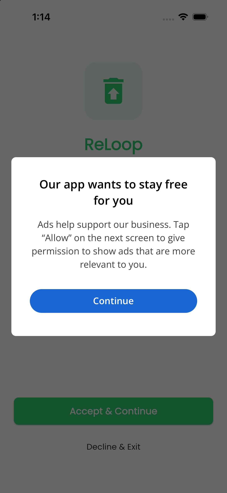 | Pass — clear copy, Continue leads to real ATT |
| Native ATT dialog | 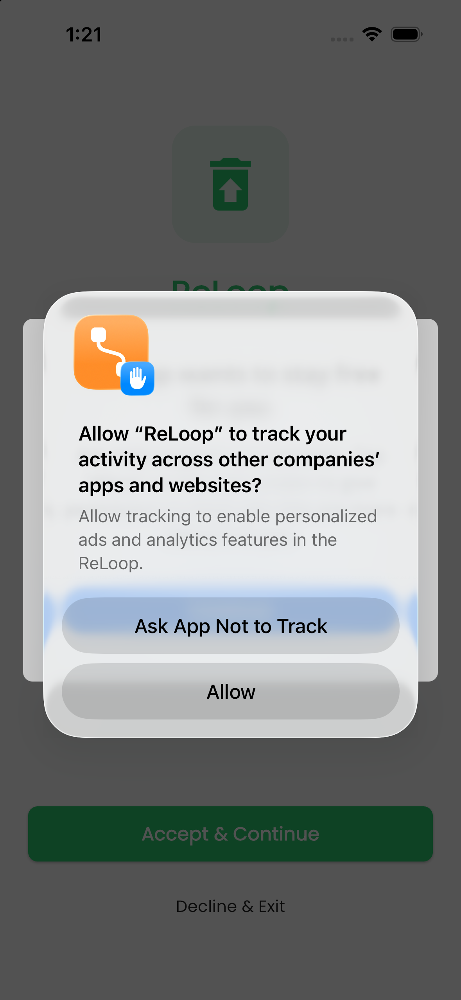 | Pass — "Ask App Not to Track" honored, app continues |
| Consent accept | p1_03/p1_04 | Pass — Accept enabled after ATT choice |
| Onboarding carousel (new vs May build) | 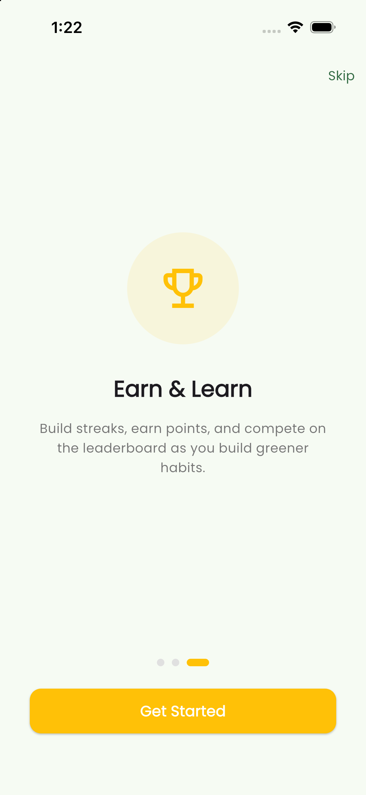 | Pass — 3 pages, Skip + swipe both work |
| Guest home dashboard | 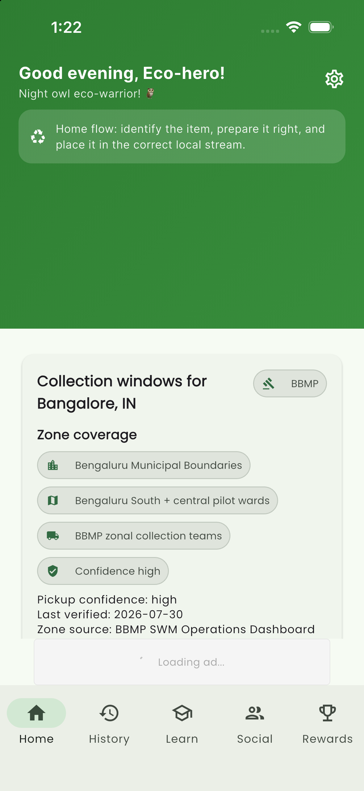 | Pass with note — hero zone renders blank (see F5) |
| BBMP policy depth | 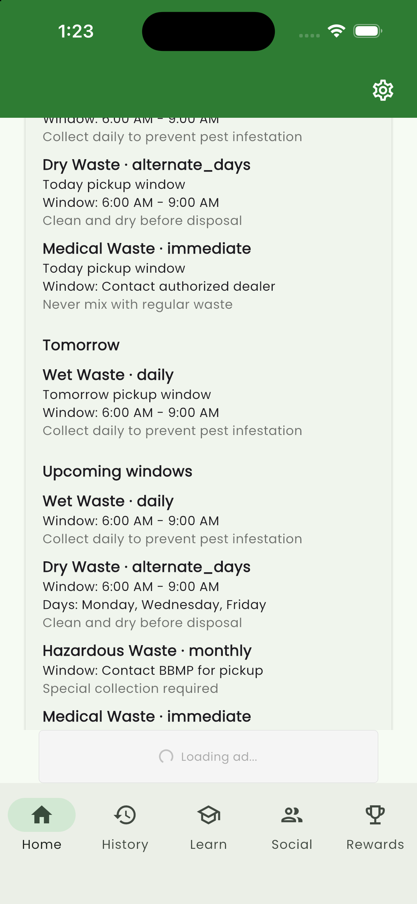 | Pass — windows, exceptions, events, helpline, provenance chips |
| Test ad loads | p1_11 | Pass — AdMob test banner renders on History |
| History → "Scan your first item" |  | **Fail (P1)** — black screen, reproducible; process stays alive |
| Home "Upload image" → picker → Review | 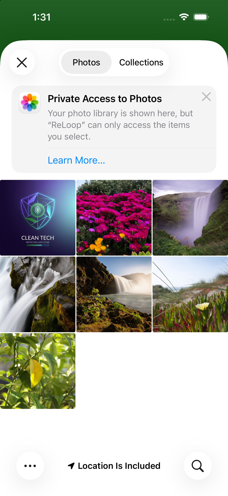 → 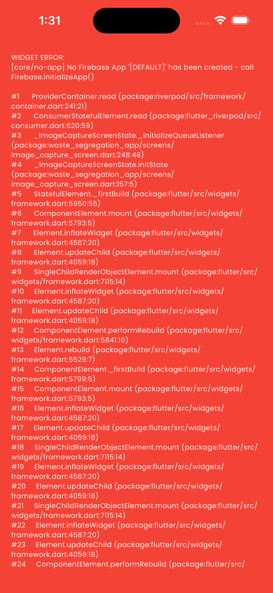 | **Fail (P1)** — PHPicker fine, then Flutter error dump |

**P1 finding — ImageCaptureScreen is broken at init on this build.**
The upload path's Review stage renders the full Flutter error screen:

```
WIDGET ERROR: [core/no-app] No Firebase App '[DEFAULT]' has been created - call Firebase.initializeApp()
  #3 _ImageCaptureScreenState._initializeQueueListener (package:waste_segregation_app/screens/image_capture_screen.dart:248)
  #4 _ImageCaptureScreenState.initState (package:waste_segregation_app/screens/image_capture_screen.dart:157:5)
```

The same screen is what "Scan your first item" opens — it renders as a featureless
black surface (process alive, no dialog, no fallback, no visible way back). On the
first occurrence the app exited to springboard entirely (no crash report was captured
in `~/Library/Logs/DiagnosticReports`). This blocks **every** classification entry
path for a first-time user. Given that May's build reached the Review screen
successfully, this is a **regression candidate** in the offline-queue/storage
migration line (Task 09 offline queue work touches exactly this listener; see
`docs/reports/SESSION_LEARNING_SALVAGE_2026-09-12.md` §9). Suggested first checks:
Firebase.initializeApp() completion order vs. first ImageCaptureScreen push, and
whatever `_initializeQueueListener` reads synchronously at initState.

---

## Sim 2 — Arjun, Busy Parent (household routine tour)

Journey: guest entry → Learn → Rewards → Social → Family discovery → Create Family
attempt. Screenshots: `p2_01`–`p2_08`.

| Step | Evidence | Result |
|---|---|---|
| Learn hub (Articles/Videos/Infographics/Quizzes, filters) | 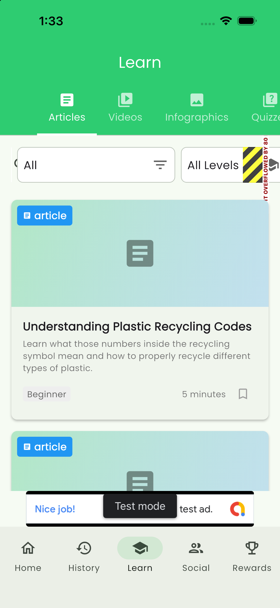 | Pass with **P2 overflow bug** |
| Rewards: Level 1 / Recycling Rookie / streak / badges | 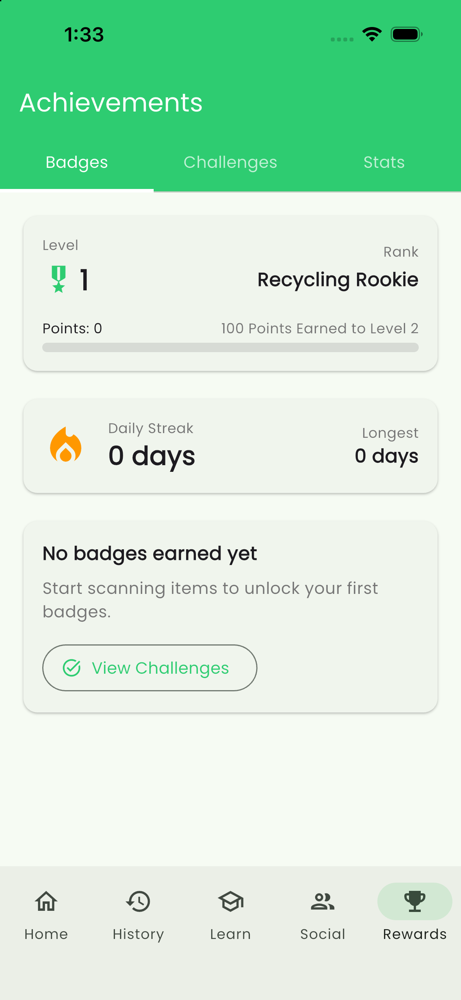 | Pass — clean empty-state gamification |
| Social: Feed/Stats/Members, empty state, Family FAB | 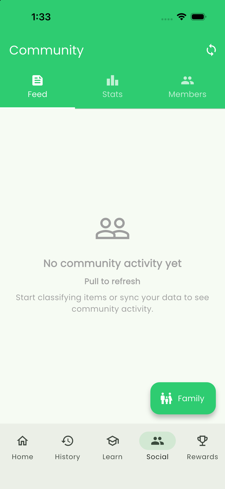 | Pass |
| Family Dashboard (Join or Create) | 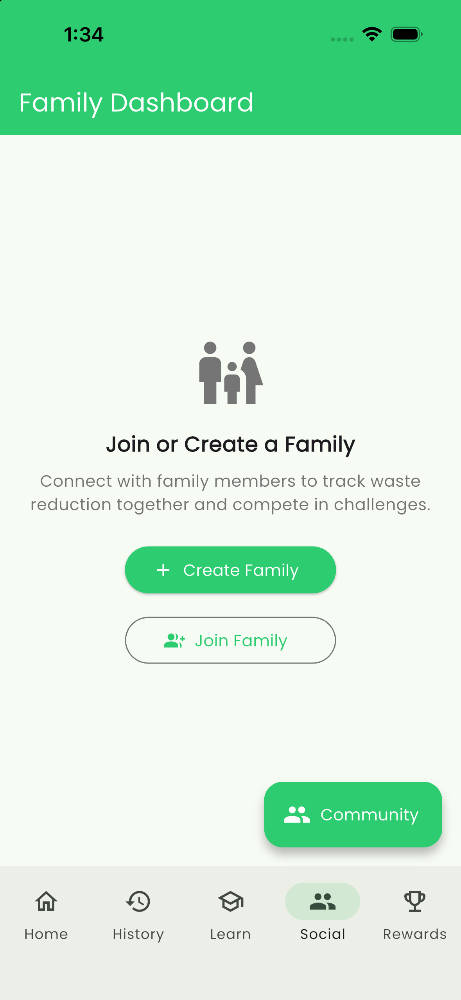 | Pass |
| Create Family form reachable as guest | p2_05, p2_06 | Pass with **P2 gate finding** |
| Empty-name validation | 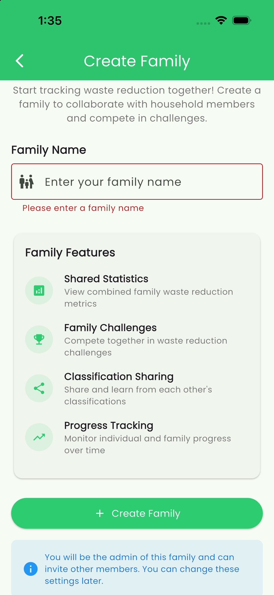 | Pass — red border + inline message |
| Valid-name submit as guest | 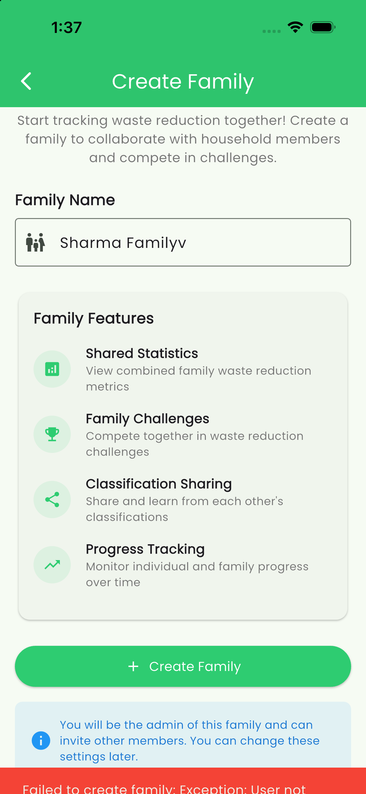 | **Fail (P2)** — raw exception snackbar |

**P2 finding — Learn filter row RenderFlex overflow.** The category/level filter row
paints black-yellow overflow stripes with "...OVERFLOWED BY 80" diagnostics text on
the right edge (visible in `p2_01`). The level chip ("All Levels") exceeds its lane;
needs a `Flexible`/shorter label/scrollable row fix.

**P2 finding — guest family creation fails late with a raw error.** A guest can open
the full Create Family form, type a name, and only at submit receive:
`Failed to create family: Exception: User not …` (truncated snackbar, bottom of
`p2_08`). The auth gate should be at entry ("Sign in to create a family"), not as a
raw exception after the user has invested effort. Note also: the inline validation
error ("Please enter a family name") remains visible after text is entered — it does
not clear on input.

---

## Sim 3 — Meera, Sustainability Champion (privacy & monetization)

Journey: Settings tour → Premium paywall → Community surfaces.
Screenshots: `p3_01`–`p3_06`.

| Step | Evidence | Result |
|---|---|---|
| Settings: account (guest mode), Reset App Data, PRO gating | 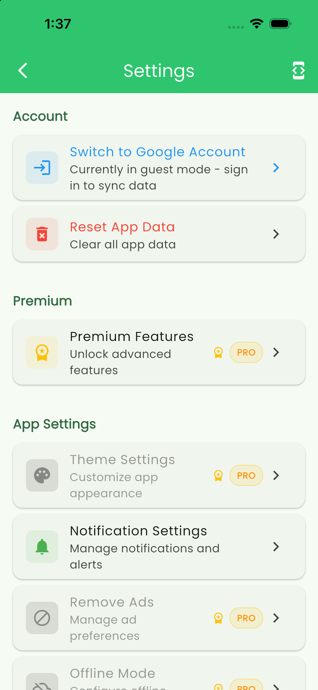 | Pass |
| Region & Local Rules → Bangalore (BBMP) selector | p3_02 | Pass — city pack selectable |
| Legal & Support (Privacy Policy, ToS, About) | p3_03 | Pass |
| Premium paywall + locked features | 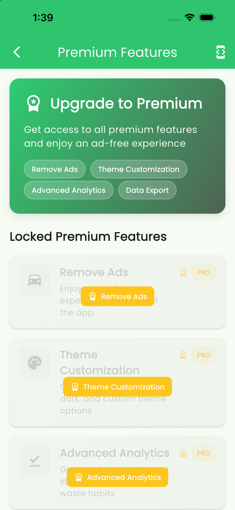 | Pass with P3 findings |
| Purchase init state | 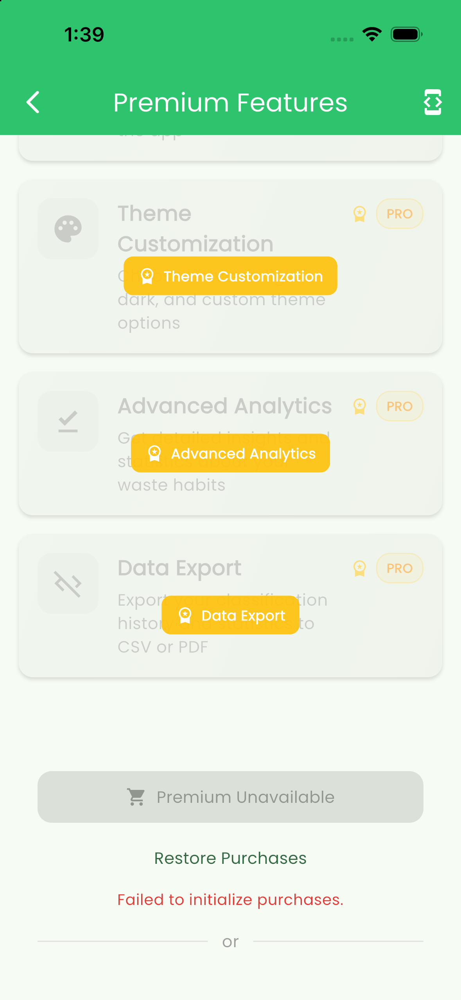 | **P3** — raw error surface |
| Social → Members | 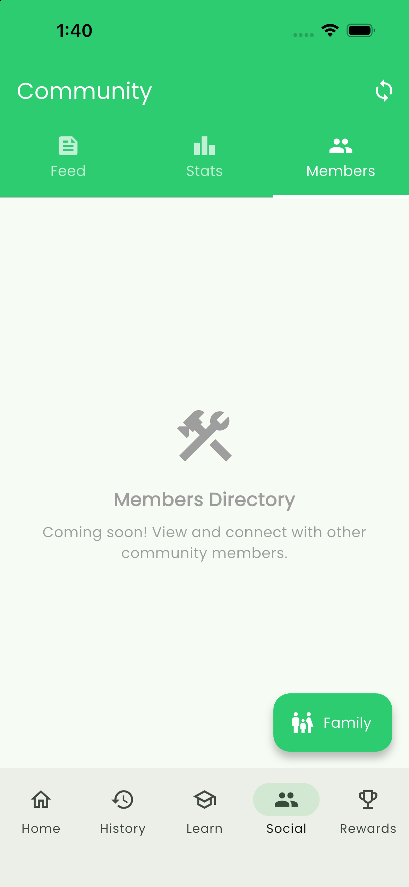 | Pass — honest "Coming soon" |

**P3 findings:**
1. **Data Export is premium-only and absent from free Settings** (`p3_04`/`p3_05`).
   For a privacy-conscious user there is currently no free-tier path to export or
   inspect their data, while "Reset App Data" (destructive) is free. Given the recent
   retention/purge privacy work, a free export path deserves a product decision.
2. **Purchases fail to initialize on this context** with the raw message
   "Failed to initialize purchases." under a disabled "Premium Unavailable" button
   (`p3_05`). Expected on a simulator/guest without store configuration, but the copy
   should be user-friendly and state the actual precondition.
3. **Session persistence is inconsistent** (observed across all three sims): after
   one relaunch the guest session was restored; after two other abnormal exits the
   app returned to pre-auth and lost the session. Needs a defined contract for
   restoring guest sessions.

---

## Consolidated Findings

| ID | Priority | Finding | Where |
|---|---|---|---|
| F1 | **P1** | ImageCaptureScreen throws `No Firebase App '[DEFAULT]'` at initState (`_initializeQueueListener`), blocking all classification paths; renders as black screen with no fallback; one observed full app exit | `lib/screens/image_capture_screen.dart:157,248` |
| F2 | P2 | Learn filter row RenderFlex overflow by 80 px | Learn tab filter row (`p2_01`) |
| F3 | P2 | Guest family creation: full form allowed, then raw `Failed to create family: Exception: User not…` at submit; gate should be at entry | Family create flow (`p2_08`) |
| F4 | P3 | No free-tier Data Export path; destructive Reset App Data is free | Settings / Premium (`p3_04`, `p3_05`) |
| F5 | P3 | Home hero action area renders blank (action rail not visible where May's build showed Take Photo/Upload cards); entries only reachable via "Start Your Journey" card far down the page | `home_screen.dart` `_buildActionChips` (home_action_rail) (`p1_08`) |
| F6 | P3 | Inconsistent guest-session persistence across relaunches | observed in sims 1–3 |
| F7 | P3 | Family-name validation error does not clear while typing | Create Family form (`p2_08`) |
| F8 | P3 | "Failed to initialize purchases." raw error on paywall (expected on sim, copy should be graceful) | Premium screen (`p3_05`) |

**What works well:** ATT chain (explainer → native prompt → honored choice), 3-page
onboarding, guest entry, BBMP policy pack depth (windows/exceptions/events/provenance),
Rewards/Achievements surfaces, Learn content hub, PHPicker privacy-limited flow,
AdMob test ads, honest "Coming soon" states.

## Follow-Up Queue

1. **F1 (P1)**: root-cause the Firebase init ordering regression on ImageCaptureScreen;
   add a guard/fallback UI; re-run Sim 1 end-to-end including Analyze (the May
   blocker) once the screen renders.
2. **F2**: fix Learn filter overflow; golden test for the filter row.
3. **F3**: gate family creation on auth at entry with a friendly sign-in prompt.
4. **F4**: product decision on free Data Export (ties into the retention/privacy work).
5. **F5**: investigate why the home action rail paints empty; restore prominent
   scan/upload entry near the top of Home.
6. Re-verify on a debug build **with** the AdMob production config phase, and on
   Android once a system image is re-downloaded (Android bench is currently dead).

## Tooling Left Behind

- `tools/sim_drive.py` — WDA driver (tap/swipe/type/source); documented in
  `tools/README.md`.
- WDA build products at `/tmp/wda-dd` and clone at `/tmp/wda` (rebuild via
  `xcodebuild build-for-testing -scheme WebDriverAgentRunner` if /tmp is cleared).
- Simulator `PersonaSim iPhone` (3A32172E-ED36-4A65-8FD9-D8B5D0F10F61) with the app
  installed and camera permission granted; app photo library seeded with one test image.
